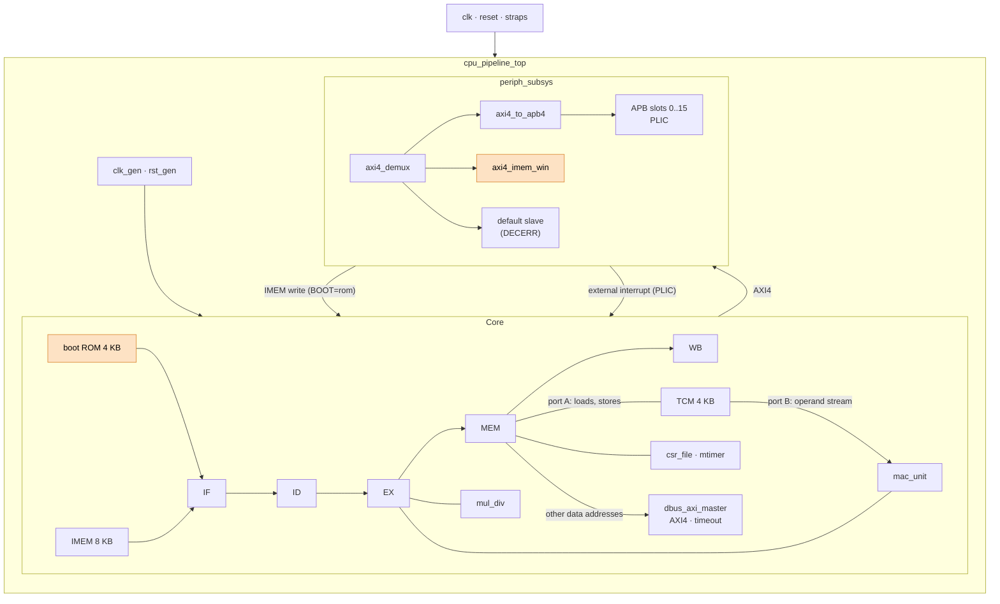

# CoreAccel-V: current architecture

This describes the RTL as it is in this repository. The source of truth is
the header comment of each file in `rtl/`; this page summarises them. For
plans, see [ROADMAP.md](../ROADMAP.md). For a design study of possible later
features (none implemented), see
[target_soc_architecture.md](target_soc_architecture.md).

## 1. Overview

- One hart, RV32IM with Zicsr, machine mode only, in-order 5-stage pipeline
  (IF, ID, EX, MEM, WB).
- A custom MAC unit on the CUSTOM-0 opcode. It multiplies a register by a
  word streamed from TCM into a 72-bit saturating accumulator.
- Harvard memory: IMEM holds code only. TCM holds all data and the stack.
- Data-side AXI4 master, then an AXI4 demultiplexer and an AXI4-to-APB4
  bridge to the peripherals: UART0, SPI, I2C, GPIO, timers/PWM/capture,
  PLIC, system control with a watchdog, and the original "legacy" page.
- Clock select and reset generator. In the BOOT=rom build there is also a
  boot ROM with a UART loader and a writable IMEM.
- FPGA target: Digilent Basys 3 (Artix-7 xc7a35tcpg236-1) at 100 MHz.
  The ASIC configuration is planned (GF180MCU) and not finished. See §11.

Orange blocks: BOOT=rom build only.

## 2. Pipeline

| Stage | Work |
|---|---|
| IF | PC register (`pc_pipe`), instruction read from IMEM (asynchronous read: LUT-ROM, or LUTRAM when writable), or from the boot ROM when the PC is in it. A PC outside IMEM and the boot ROM fetches nothing valid and is marked with a fetch fault. |
| ID | Decode (`control_unit_pipe`), immediates (`imm_gen_pipe`), register file read (`register_file`, 32 x 32). Exceptions found here (fetch fault, illegal instruction, EBREAK, ECALL) and interrupts tag the instruction, which then travels as a bubble and traps in MEM. |
| EX | ALU, branch and jump resolution, address generation, CSR read, start of MAC and multiply/divide operations. Misaligned loads and stores are detected here and squashed. The TCM address and write enable are produced here, so a TCM access completes in MEM. |
| MEM | TCM read data, or a data-bus access through the AXI master. Traps and MRET are taken here. |
| WB | Register file write. |

### Hazards and forwarding

- **Forwarding** from EX/MEM and MEM/WB to EX (`forwarding_unit`). The mux
  selects are computed one cycle early and registered, which keeps them off
  the critical path.
- **Load-use:** a load followed by a dependent instruction inserts one bubble
  (`hazard_detection_unit`).
- **Branches and jumps** resolve in EX. A taken branch or a jump redirects
  the PC and flushes IF/ID and ID/EX: 2 cycles. The pipeline flushes by
  clearing valid bits.
- **EX hold** (`ex_hold`): MAC operations, READ_SHIFT and the RV32M unit hold
  their instruction in EX until the unit finishes. IF, ID and EX freeze and
  a bubble goes into MEM. Multiply takes 2 busy cycles and divide 33.
- **Global MEM stall** (`mem_stall`): a data-bus access holds MEM until the
  bus answers. It freezes every pipeline register, so the access completes
  exactly once, whatever the number of wait states.

### Traps and interrupts

- Precise traps, taken in MEM. The CSR file saves `mepc`, `mcause` and
  `mtval`. The PC goes to `mtvec` (direct mode only), and IF, ID and EX are
  flushed. A trap or MRET in MEM wins over any redirect or hold younger
  than it.
- Causes: 0 instruction address misaligned (jump target), 1 instruction
  access fault, 2 illegal instruction, 3 breakpoint, 4/6 load/store address
  misaligned, 5/7 load/store access fault (bus error, decode error or bus
  timeout, `mtval` = address), 11 ECALL. Interrupts: 7 machine timer, 11
  machine external (from the PLIC). MEI has priority over MTI.
- Interrupts are taken by tagging the instruction in ID, so it traps in MEM
  like an exception.

### CSRs (machine mode)

`mstatus` (MIE, MPIE; MPP fixed at M), `misa` (RV32 I M X, read-only),
`mie`/`mip` (MTIE/MTIP, MEIE/MEIP), `mtvec`, `mepc`, `mcause`, `mtval`,
`mscratch`, `mcycle[h]` and `minstret[h]` (64-bit, writable), read-only
`cycle`, `instret` and `time` shadows. The remaining standard M-mode
registers (`mhartid`, `mvendorid`, `mhpmcounter*`, ...) read 0.

## 3. CUSTOM-0 MAC unit

Opcode `0001011` (CUSTOM-0), funct7 = 0, funct3 selects the operation:

| funct3 | Instruction | Effect |
|---|---|---|
| 000 | `MAC rs1, rs2` | acc += rs1 x TCM[rs2] (32 x 32 signed into a 72-bit accumulator that saturates) |
| 001 | `MAC_CLEAR` | acc = 0, overflow = 0 |
| 011 | `MAC_READ_LO rd` | rd = sat64(acc)[31:0] |
| 100 | `MAC_READ_HI rd` | rd = sat64(acc)[63:32] |
| 101 | `MAC_READ_SHIFT rd, rs1` | rd = sat32(round_half_up(acc >>> rs1[5:0])) |
| 110 | `MAC_READ_STATUS rd` | rd = sticky overflow flag |
| 010, 111 | reserved | illegal instruction |

The second operand is streamed from TCM port B. The address is presented on
the start cycle. The FSM then absorbs the BRAM latency (S_INPUT), multiplies
(S_MULTIPLY) and adds the product in two halves (S_MULTIPLY and
S_ACCUMULATE), which splits the 72-bit carry chain. READ_SHIFT rounds and
then shifts (S_RS_ROUND, S_RS_SHIFT). Both hold EX until the FSM is idle,
so no redirect can arrive while one is in flight. The overflow flag is
sticky. It is set when the accumulator saturates or a read has to saturate,
and only MAC_CLEAR clears it.

## 4. Memory map

| Address | Size | What | Notes |
|---|---|---|---|
| 0x0000_0000 | 8 KB | IMEM | instruction fetch only. LUT-ROM in the default build, LUTRAM (writable) in BOOT=rom |
| 0x0001_0000 | 4 KB | boot ROM | BOOT=rom build only. Fetch only: a data read answers DECERR (access fault) |
| 0x1000_0000 | 8 KB | IMEM write window | BOOT=rom build only. Full-word single writes go to IMEM. Partial writes, bursts and reads answer SLVERR |
| 0x8000_0000 | 4 KB | TCM | all data, .rodata, .bss and the stack. Block RAM, true dual port (A: loads/stores, B: MAC operands) |
| 0xC000_0000 | 4 KB | slot 0: legacy page | see §6 |
| 0xC000_0100 | 16 B | mtime, mtimecmp (lo/hi) | core-local (inside slot 0's range, never reaches the bus) |
| 0xC000_0FFC | 4 B | simulation halt word | core-local, writes ignored by the RTL |
| 0xC000_1000 | 4 KB | slot 1: UART0 | PLIC source 1 |
| 0xC000_2000 | 4 KB | slot 2: SPI master | PLIC source 2 |
| 0xC000_3000 | 4 KB | slot 3: I2C master | PLIC source 3 |
| 0xC000_4000 | 4 KB | slot 4: GPIO | PLIC source 4 |
| 0xC000_5000 | 4 KB | slot 5: timers, PWM, capture | PLIC source 5 |
| 0xC000_8000 | 4 KB | slot 8: system control | |
| 0xC000_6000, 7000, 9000-F000 | | reserved slots | PSLVERR (access fault) |
| 0xC400_0000 | 4 MB | PLIC | standard layout, sources 1-16, one context |
| anything else | | | DECERR from the default slave (access fault) |

TCM and the core-local words are decoded in the core and never go over AXI.
Every other data address goes over the bus.

## 5. Bus

- **`dbus_axi_master`:** turns a MEM-stage load or store into one AXI4
  single-beat transaction. It holds `mem_stall` until the response arrives.
  An access with no response after 256 cycles (`BUS_TIMEOUT`) ends as an
  access fault. The late response is then drained.
- **`axi4_demux`:** one master to N slaves, with a built-in default slave
  that answers DECERR. It allows one outstanding read and one outstanding
  write. The slave index is registered at the address phase. The header
  describes where a 2-master arbiter goes when a DMA engine is added.
- **`axi4_to_apb4`:** AXI4-to-APB4 bridge with a select per 4 KB slot and the
  PLIC region. A slave error (PSLVERR) becomes SLVERR, which is an access
  fault.
- **`axi4_imem_win`:** the IMEM write window (BOOT=rom build only).

## 6. Peripherals and register maps

All registers are 32-bit words. An undefined offset answers PSLVERR (access
fault). All peripherals have zero wait states. The register tables below
are summaries. The full bit fields are in each module's header.

### Slot 0: legacy page (`apb_legacy_page`)

| Offset | Register |
|---|---|
| 0x0 | GPIO: write bit0 = SCL, bit1 = SDA (1 release, 0 drive low). Read: synchronised pins |
| 0x4 | one-way telemetry UART TX: write sends data[7:0]. Read bit0 = busy |
| 0x8 | 7-segment value [15:0] (FPGA build only) |
| 0xC | GPIO output latch (read-only) |

### Slot 1: UART0 (`apb_uart`), 8N1, 16-byte TX and RX FIFOs

| Offset | Register |
|---|---|
| 0x00 | TXDATA: write pushes a byte. Read bit31 = TX FIFO full |
| 0x04 | RXDATA: bit31 = RX empty, else [7:0] = byte (popped) |
| 0x08 | STATUS: TX idle, TX full, RX not empty, RX full, overrun, framing error, FIFO levels |
| 0x0C | CTRL: TX/RX enable, loopback, TX/RX watermarks |
| 0x10 | DIV: clocks per bit (reset CLK_FREQ / BAUD_RATE) |
| 0x14 / 0x18 | IE / IP: TX watermark, RX watermark, error |

### Slot 2: SPI master (`apb_spi`), modes 0-3, 8-byte FIFOs, 2 chip selects

| Offset | Register |
|---|---|
| 0x00 / 0x04 | TXDATA / RXDATA (as UART0) |
| 0x08 | STATUS: busy, FIFO flags and levels |
| 0x0C | CTRL: EN, CPHA, CPOL, LSB first, watermarks |
| 0x10 | DIV: SCK = clk / (2 x (DIV + 1)) |
| 0x14 | CS: manual chip selects |
| 0x18 / 0x1C | IE / IP: TX watermark, RX watermark, idle |

### Slot 3: I2C master (`apb_i2c`), byte commands

| Offset | Register |
|---|---|
| 0x00 | CTRL: EN, PAD_SEL (pads to this controller; reset = legacy bit-bang) |
| 0x04 | PRESC: SCL quarter period = PRESC + 1 clocks (reset 100 kHz) |
| 0x08 / 0x0C | TXDATA / RXDATA |
| 0x10 | CMD: START (or repeated START), STOP, WRITE, READ, NACK (with READ) |
| 0x14 | STATUS: in progress, received ACK, arbitration lost, bus busy, done, NACK, bus owned, ignored command |
| 0x18 / 0x1C | IE / IP: DONE, NACK, arbitration lost |

### Slot 4: GPIO (`apb_gpio`), 16 pins

OUT 0x00, OE 0x04, IN 0x08 (2-FF synchronised), SET 0x0C, CLR 0x10, IE
0x14, MODE 0x18 (edge/level), POL 0x1C, BOTH 0x20 (both edges), STATUS 0x24
(sticky edge events, write 1 to clear).

### Slot 5: timers, PWM, input capture (`apb_timer`)

| Offset | Register |
|---|---|
| 0x00 / 0x04 | STATUS (W1C) / IE: timer match, capture, capture overflow, PWM wrap |
| 0x08 | PWM_PRESC |
| 0x10 + 0x10 x t | timer t (2 x 32-bit): CTRL (EN, ONESHOT), PRESC, CMP, COUNT |
| 0x40 + 0x10 x k | PWM channel k (4): CTRL (EN, POL), PERIOD, DUTY (shadowed to the next wrap), COUNT |
| 0x80 + 0x10 x j | capture channel j (2): CTRL (EN, rising, falling), PRESC, COUNT, CAPT |

### Slot 8: system control (`apb_sysctl`)

| Offset | Register |
|---|---|
| 0x00 | CHIP_ID ("CAV1" = 0x4341_5631) |
| 0x04 | VERSION |
| 0x08 | BOOT: boot-mode strap [1:0], clock-select strap [8] (latched at reset) |
| 0x0C | RST_CAUSE (W1C): pin, watchdog, software |
| 0x10 | SW_RESET: write the key 0x5352_5354 to reset the system |
| 0x20-0x2C | SCRATCH0-3: reset by the pin only, so they survive watchdog and software resets |
| 0x40 | WDT_CTRL: EN, LOCK (once set, the watchdog cannot be changed until reset) |
| 0x44 / 0x48 | WDT_LOAD / WDT_COUNT |
| 0x4C | WDT_KICK: write the key 0x4B49_434B to reload |

### PLIC (`apb_plic`), 0xC400_0000

Standard layout, one context (hart 0, M-mode): priority per source at 4 x id,
pending at 0x1000, enables at 0x2000, threshold at 0x20_0000, claim/complete
at 0x20_0004. Sources: 1 UART0, 2 SPI, 3 I2C, 4 GPIO, 5 timers. Sources 6-16
are unused. Level-triggered gateways. The output drives MEIP.

### Machine timer (`mtimer`)

`mtime` and `mtimecmp` (64-bit) at 0xC000_0100-0x10C. They are decoded in the
core, not on the bus. MTIP = mtime >= mtimecmp.

## 7. Clock and reset

- **`clk_gen`:** the clock-select strap (sampled while reset is held) picks
  bypass or a PLL slot. The FPGA build passes the board clock through. The
  ASIC option (`CLK_TECH = "ASIC"`) uses the glitch-free mux `clk_mux_gf`,
  which is lint-checked but not yet used in a build.
- **`rst_gen`:** `rst_por` (from the pin only: asynchronous assert,
  synchronised release) and `rst_sys`, which also takes the stretched
  watchdog reset and the software reset. Every block resets on `rst_sys`.
  The reset cause, the scratch registers and the strap latch reset on
  `rst_por`, so they survive internal resets. Leaf flops use `rst_sys` as a
  synchronous reset.
- Every asynchronous input goes through a 2-flop synchroniser: UART RX, I2C
  pads, GPIO, capture inputs, straps and the external interrupt line.

## 8. Boot

Two builds, selected by parameters on `cpu_pipeline_top`:

| | Default build | BOOT=rom build |
|---|---|---|
| Parameters | none (`RESET_VECTOR = 0`, `IMEM_WRITABLE = 0`) | `RESET_VECTOR = 0x0001_0000`, `IMEM_WRITABLE = 1`, `BAUD_RATE` |
| Reset | PC = 0x0000_0000, program baked into the IMEM LUT-ROM | PC = 0x0001_0000, boot ROM |
| IMEM | LUT-ROM | LUTRAM with a write port, written through the window at 0x1000_0000 |
| Make target | `make bit` | `make bit-rom` |

The boot ROM (`boot/loader.S`, built by `make bootrom`) uses only registers,
with no stack or TCM, so a load can target all of TCM. It reads the
boot-mode strap from system control:

- **mode 1:** jump to 0x0000_0000 (IMEM already holds the program).
- **mode 0 (and 2, 3, reserved for SPI flash):** load over UART0 (8N1 at the
  reset baud rate).
  - The host sends the magic "CAVB". The loader answers ACK 0x06.
  - The host then sends frames: addr(4), len(4), data(len), crc(4). Words
    are little-endian. The CRC is CRC-32 (zlib) over addr, len and data.
  - Address and length must be word-aligned, the length at most 4096, and
    the range entirely in IMEM or in TCM.
  - Answers: ACK 0x06 (stored), NAK 0x15 (bad CRC: the host resends), ERR
    0xE1 (bad magic), 0xE2 (4th bad CRC in a row) and 0xE3 (bad
    address/length). After an ERR the loader empties the RX FIFO and waits
    for the magic again.
  - A frame with len = 0 is the last one, and its addr is the entry point.
    The loader waits until its ACK has left the transmitter, then jumps.

`scripts/load.py` builds the frames from an ELF or from the hex images and
either sends them (`--port`) or writes them to a file for simulation
(`--emit`). IMEM writes are only safe from the boot ROM or from code far
from the patched words. There is no `fence.i`.

## 9. Memory implementation

| Memory | FPGA | ASIC (planned) |
|---|---|---|
| IMEM (`imem_wrap`) | LUT-ROM, or LUTRAM with an asynchronous read when writable | SRAM macro. The read is synchronous, so IF must be re-pipelined first (the "ASIC" option stops elaboration with an error until then) |
| TCM (`tcm_wrap`) | 1 block RAM, true dual port | SRAM macro |
| boot ROM (`bootrom_wrap`) | LUT-ROM | ROM macro or logic (same IF re-pipeline) |

## 10. Verification

- Directed, self-checking assembly tests in `tests/` run on the top level in
  Vivado xsim (`make regress`). There are also unit testbenches in
  `tb/unit/` and a generated random RV32M test.
- `tb/tb_top.sv` provides the harness: a commit monitor, SVA checks on the
  core and the bus, models of an SPI flash, an SPI echo target and an I2C
  target, a UART monitor, and the boot-loader driver for the BOOT=rom tests.
- Stress settings: `HOLD=n` holds every TCM store in EX for n cycles, and
  `WAIT=n|rand` adds wait states to every bus access. `BUS_VIP=1` adds the
  Xilinx AXI protocol checker. The regression is run at HOLD = 0..3 with
  WAIT = 0, rand and 3.
- Verilator `--lint-only -Wall` runs in three configurations: default,
  BOOT=rom and the ASIC clock mux.

## 11. Not done yet

- Not yet run on the board. The strap, SPI, GPIO, PWM and capture pins in the
  XDC are provisional.
- No DMA, no cache, no external memory.
- No `fence.i`, and IMEM is not writable in the default build.
- ASIC: the IMEM and boot ROM SRAM macros need an IF re-pipeline. The
  register file still resets every register. The reset style (asynchronous
  or synchronous leaf flops) and the reset tree are open. The synchronisers
  need a CDC review. Pads are not done.
